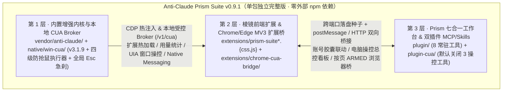

# Anti-Claude Prism Suite

<p align="left">
  
  
  
  
  
</p>

**面向 Google Antigravity Desktop（Windows / WSL2 / macOS / Linux）的一体化独立完整版体验增强、跨厂商模型会诊、受控电脑操控（CUA）与多账号工程工作台套件。**

自 **v0.6.0+** 起，本项目已**原生内嵌继承增强版 [Anti-Claude](https://github.com/hongqi7/Anti-Claude) `v3.1.9` 运行时内核（`vendor/anti-claude/`）**，并在 **v0.9.0** 全面升级为涵盖 **「免预装 Node.js 一键运行内核 + 棱镜光学微交互与自定义字体扩展 + 七合一响应式工作台 + 默认关闭零开销受控电脑操控桥（独立可视化虚拟指针 + 四级防抢鼠路由 + Chrome/Edge MV3）+ 双模 SQLite FTS5 记忆 + 零依赖 SSE 模型会诊中枢 + 3 项内置工程 Skill」** 的全栈自包含套件：
- **真正零前置依赖（免装系统 Node.js 亦可运行）**：Windows 用户双击运行单个安装包，即使电脑未安装 Node.js 也会自动复用本机 `Antigravity.exe` 内置 Electron 运行时（`ELECTRON_RUN_AS_NODE=1`）一次性完成「底层 CDP 守护内核 + 棱镜视觉交互扩展 + Prism 七合一工作台 + 默认关闭的 `prism-cua` + Chrome/Edge 浏览器受控桥 + 内置规则与技能」全栈部署；
- **默认关闭零上下文损耗 · 可视化虚拟指针防抢鼠 · 全局 `Esc` 急刹**：受控电脑与浏览器操控工具独立封装在同级插件 `prism-cua` 中并默认关闭，日常写代码聊天时 `0` 额外工具 Token 开销；操控期间渲染独立鼠标穿透 **AI 虚拟指针**，对已授权网页与标准桌面 UIA / Win32 控件实现 **`0px` 物理鼠标位移、零焦点抢占**，全链路硬拦截密码/验证码/支付框（含 `Ctrl+V` 剪贴板粘贴防护），并在系统任意窗口按下物理 **`Esc`** 键毫秒级中断急刹；
- **老用户无感平滑升级 · 全链路杀软零误报卫生**：完整保留本地 `ui-prefs.json` 与已隐藏说明偏好，支持运行中进程免停机 `.old` 原子热替换，采用纯二进制 `[MS-SHLLINK]` `.lnk` 编解码与标准 `[ComImport] IShellLinkW` 彻底告别 `WScript.Shell` 误报特征；
- **零外部运行时依赖 · 零全局 Body 观察器 · 三档性能与光学质感**：全栈基于原生 ESM、`.NET Framework 4.8` 系统自带编译器与浏览器原生 API 实现；支持 `省电 / 均衡 / 满血` 三档性能模式、对话/代码独立自定义字体、长代码块吸顶折叠防跳飞、思考块 `#L` 源码直跳及 `0fps` 语义边缘余晖与紧凑双池额度胶囊。

---

## 目录导航

- [实机演示画廊](#-实机演示画廊)
- [三层一体化架构](#-三层一体化架构)
- [核心功能详解](#-核心功能详解)
  - [一、内置增强版 Anti-Claude v3.1.9 内核与 Windows 原生适配](#一内置增强版-anti-claude-v319-内核与-windows-原生适配)
  - [二、顶栏「✦ 棱镜」视觉、像素伙伴与高效工作流套件](#二顶栏-棱镜视觉像素伙伴与高效工作流套件)
  - [三、Prism 七合一工作台（窄栏 & 全局宽屏自适应 MCP App）](#三prism-七合一工作台窄栏--全局宽屏自适应-mcp-app)
  - [四、受控电脑与浏览器操控桥（Default-Off `prism-cua` · `Esc` 急刹 · Chrome MV3 桥）](#四受控电脑与浏览器操控桥default-off-prism-cua--esc-急刹--chrome-mv3-桥)
  - [五、内置 MCP 工具矩阵与双轨配置说明](#五内置-mcp-工具矩阵与双轨配置说明)
  - [六、随包内置的 3 项工程协作 Skill](#六随包内置的-3-项工程协作-skill)
- [安装、自更新与干净卸载](#-安装自更新与干净卸载)
- [安全、隐私与隔离承诺](#-安全隐私与隔离承诺)
- [常见问题排查（FAQ）](#-常见问题排查faq)
- [上游生态雷达与开源许可](#-上游生态雷达与开源许可)

---

## 实机演示画廊

> 所有演示截图均基于真实界面组件在无头渲染环境中以虚构示例数据（`@example.com` / `/workspace/aurora-design-system`）生成，不包含任何真实用户隐私。

### 1. 主工作区全景效果

<p align="center">
  <br />
  <sub>主工作区全景：顶栏 <code>✦ 棱镜</code> / <code>大纲</code> / <code>工作台</code> 双向开关入口 · 对话流沉浸式中文思考块 · 输入框像素伙伴与实时速率指标 · 右侧概览面板（分池配额、近 14 天趋势、名著体量换算与周一对齐 12 周热力图）</sub>
</p>

### 2. Windows 一键独立完整版安装器（内置内核 + 扩展 + 双端插件）

<p align="center">
  <br />
  <sub>双击即用：自动释放内置 <code>Anti-Claude v3.1.9</code> 增强内核、补齐桌面快捷方式 <code>--remote-debugging-port=0</code>、拉起后台无窗守护进程，并同步原地部署 Windows 与 WSL2 插件（保留目录句柄）</sub>
</p>

### 3. Prism 工作台核心视图（目录行号预览 · 多账号分层接力 · 官方自更新与上游雷达）

<table>
  <tr>
    <td align="center" width="33%" valign="top">
      <br />
      <sub><b>目录浏览 &amp; 行号区间引用</b><br />窄栏上下分栏 / 宽屏左右主从常驻分栏、原生拖拽文件入框、<code>Shift+点击</code> 行号生成精确引用与 SHA-256 乐观锁保存</sub>
    </td>
    <td align="center" width="33%" valign="top">
      <br />
      <sub><b>主备多账号分层安全接力</b><br />宽屏双栏指挥台布局：在线双池并排仪表卡 + 待切换决策卡；全模型池木桶短板一票否决防误推</sub>
    </td>
    <td align="center" width="33%" valign="top">
      <br />
      <sub><b>官方一键更新 &amp; 7 源上游雷达</b><br />SHA-256 校验一键原地自更新；勾选候选变更后一键合并复制 Clean-room 评估融合指令</sub>
    </td>
  </tr>
</table>

### 4. 深浅多主题配色与顶栏控制中心细节

<table>
  <tr>
    <td align="center" width="50%">
      <br />
      <sub>浅色 · <b>暖白画册</b>（温润纸感暖白底 + 暖棕强调色，配额条与热力图色阶自动联动）</sub>
    </td>
    <td align="center" width="50%">
      <br />
      <sub>深色 · <b>深空黑曜</b>（纯黑冷峻深空高对比，适配夜间长时间编码阅读）</sub>
    </td>
  </tr>
  <tr>
    <td align="center" width="50%" valign="top">
      <br />
      <sub><code>✦ 棱镜</code> 控制面板：顶部常驻实时账号额度胶囊（一键 <code>⚡ 切号</code>）、8 套双色主题卡与全模块独立开关</sub>
    </td>
    <td align="center" width="50%" valign="top">
      <br />
      <sub>概览「用量统计」：14 天 Token 柱状图 + 《四库全书》/《三体》体量换算 + 周一自然周对齐 12 周热力图</sub>
    </td>
  </tr>
  <tr>
    <td align="center" width="50%" valign="top">
      <br />
      <sub>会话大纲抽屉（<code>Alt+O</code> 呼出 · <code>Alt+↑/↓</code> 按视口跳轮 · 悬停一键发起 <code>/btw</code> 旁路追问）</sub>
    </td>
    <td align="center" width="50%" valign="top">
      <br />
      <br />
      <sub>上：无框柔灰融入原生对话流的<b>沉浸式中文思考转译</b>（右上角一键 <code>查看原文</code>）<br />下：输入框上方<b>像素小伙伴动态进退场</b> + 上下文圆环 + <code>tok/s · TTFT</code> 实时速率</sub>
    </td>
  </tr>
</table>

---

## 三层一体化架构



| 仓库目录 | 部署目标路径 | 职责说明 |
| --- | --- | --- |
| `vendor/anti-claude/` & `native/win-cua/` | `~/.gemini/antigravity/anti-claude/runtime/` | 内置 `Anti-Claude v3.1.9` MIT 内核 + 现场编译的 `bin/prism-win-cua.exe`（含 `.sha256`）、本地 CUA Broker、全局 `Esc` 急刹监听、无窗 `git` 状态缓存与 WSL↔Win 桥接 |
| `extensions/` | `~/.gemini/antigravity/anti-claude/user/extensions/` & `.../prism-suite/chrome-bridge/` | 6 个桌面增强扩展文件 + 跨端口偏好种子 `prism-suite-00-prefs.js` + Chrome/Edge MV3 受控浏览器桥（固定 ID `lbmibnghmlnidfiihkegicaejaacmkca`） |
| `plugin/` | `~/.gemini/config/plugins/prism-files/` | 原生 MCP App 七合一工作台（含「电脑操控」总控看板）、严格 8 个常驻模型可见工具、自动文件卡片规则与 3 个内置 `skills/` |
| `plugin-cua/` | `~/.gemini/config/plugins/prism-cua/` | **默认关闭（Default-Off）**的受控电脑与浏览器操控 MCP 插件（仅含 `cua_status` / `cua_observe` / `cua_act` 三个工具，平时零 Token 开销，按需启用） |
| `installer/win/` | 编译产出 `dist/Anti-Claude-Prism-Suite-Setup.exe` | 纯 `.NET Framework 4.8` 原生单文件安装器（现场编译内嵌 `prism-win-cua.exe`，自动同步 Windows 与 WSL2 双插件环境） |

---

## 核心功能详解

### 一、内置增强版 `Anti-Claude v3.1.9` 内核与 Windows 原生适配

1. **完整继承上游 `v3.1.9` 全部桌面能力**：
   - 右侧原生风格 **「概览（Overview）」面板**（工作区 Git 状态、上下文缓存命中率、一键 `/compact` 压缩、实时分池配额条、Sidechats 与连接器概览）；
   - 输入框底部 **上下文占用圆环**、**`tok/s · TTFT` 实时生成速率**、工具步骤展开计时器、长代码块折叠吸顶及 **Project 输入框拖拽/粘贴本地文件与目录**。
2. **Windows / WSL2 深度原生化校准**：
   - **彻底根除后台黑框闪烁**：守护进程与插件服务全链路子进程调用（`git`、`powershell`、`explorer.exe`、`wsl.exe`）均强制启用 `windowsHide: true`，并对尚未产生首次 Commit（unborn branch）的 Git 仓库做原生兼容，消除回退连发；
   - **渲染层优先的快捷键与术语自适应**：即使后台运行于 WSL2 Linux，桌面渲染端依然精准识别 Windows 宿主，将界面增强设置、模型浮层与工作环境按钮自动适配为 **`Ctrl+/`**（兼容中文输入法 `Slash` 物理键码，且避让 Monaco 编辑器与终端注释快捷键）、**`Alt+点击`**、**`资源管理器 ↗`**、**`在资源管理器中显示`** 与 **微软雅黑 / 苹方** 双平台字高校准（macOS 下自动保持 `⌘/`、`⌥ 点击`、`Finder ↗`）；
   - **左侧边栏滚轮透传修复**：解决统一最近对话列表在 Electron 拖拽区或折叠容器上无法顺滑响应鼠标滚轮的问题。

### 二、顶栏「`✦ 棱镜`」视觉、像素伙伴与高效工作流套件

点击窗口顶栏右侧 **`✦ 棱镜`** 按钮打开控制中心（支持一键显隐顶栏 `工作台` 快捷入口 `showWorkbenchBtn`；所有开关通过 `localStorage` + 同源 Cookie + 守护进程 `savePrismUiPrefs` 实时写入本地 `prism-suite-00-prefs.js` 与 `ui-prefs.json`，**切换账号或重启换端口后 100% 保持你的设定**）：

1. **8 套深浅双色主题卡（随系统/宿主亮暗自动切换）**
   - **浅色 4 套**：`纯白默认` / `白昼冷晶` / `暖白画册` / `松雾青岚`
   - **深色 4 套**：`暖炭默认` / `深空黑曜` / `暖炭玄岩` / `深海墨蓝`
2. **会话大纲抽屉 + 可开关的轮次圆点目录（`#ag-ps-outline-rail`）**
   - 顶栏 **`大纲`**（或 `Alt+O`）呼出带实时筛选的轮次导航（再次点击收起）；`Alt+↑` / `Alt+↓` 按当前视口位置上下跳轮；悬停任意历史轮次点 **`btw`** 一键带入 `/btw` 支线提问；
   - **轮次圆点目录轨**：默认开启常驻显示（兼容单轮提问、纯图片附件提问与长对话虚拟滚动，高不透明胶囊无底部灰影，遇右侧概览/菜单展开自动左移避让）；**不喜欢常驻的用户可在 `✦ 棱镜 → 视觉特效与排版 → 轮次圆点目录（右侧常驻）` 随时一键关闭**，开关状态跨账号与重启持久生效。
3. **12 款高清像素小伙伴（真实跟随子 Agent 进退场 + 5 大彩蛋）**
   - 内置 **12 款像素锐化 SVG 角色**（橘蟹 / 紫猫 / 蓝史莱姆 / 绿蛙 / 金雏 / 粉兔 / 赤狐 / 柴犬 / 企鹅 / 猫头鹰 / 六角恐龙 / 机甲小宝），提供 `经典六萌`、`全员动物园`、`极客萌团` 与单宠专宠模式，以及 `16px ~ 36px` 全局尺寸滑块；
   - **真实子 Agent 生命周期映射**：开启 `跟随 Agent` 模式后，伙伴数量严格对应 **`1 主控 + 当前正在运行（running）的子 Agent 数`**；新子 Agent 启动时欢跳入场，子 Agent 执行完毕后自动播放**挥手道别退场动画**并移除节点，绝不残留僵尸小精灵；
   - **5 大互动彩蛋**：单击伙伴随机换装并冒音符、三连摸头触发 360° 空翻/果冻弹跳、两宠擦肩停步击掌、任务收官集体庆典跳跃、深夜时段（23:00–05:00）空闲犯困冒泡 `zzZ`（空闲 5s 后自动进入 `0fps` 静止省电态）。
4. **名著体量换算 + 12 周热力图 + 五级水墨吐字 + 思考中译**
   - 概览底部嵌入今日 / 12 周 Token 名著折算与周一对齐热力图；
   - 水墨吐字仅在流式输出期局部挂载 `CSS.highlights`（`30fps` 限频），平时 `0ms` 零监听；思考块支持 `关闭 / 双语对照 / 沉浸中文` 三档切换。
5. **高清防模糊视觉特效、光学微切面、自定义字体与三档性能模式（`prism-suite-fx` & `workflow`）**
   - 支持 **`省电（0fps 静态节能） / 均衡 / 满血`** 三档性能模式、`忽略系统「减少动画」` 独立开关，以及**对话正文与代码等宽字体**独立预设/自定义输入；
   - 提供 `<kbd>` 微立体键帽与文件变更/Artifact 卡片顶边 `1px` 光学高光、分屏拖拽条 `1px` 隐形极细微光线、输入框三态 `0fps` 语义边缘余晖（待确认琥珀金 / 异常珊瑚红 / 完工翡翠绿，聚焦即消退）及底栏紧凑 `5h · 7d` 双池额度胶囊；
   - 未折叠长代码块顶栏 Sticky 吸顶 + 收起时视口 `scrollTop` 防跳飞补偿，思考块中译文源码路径 `#L` 行号一键定位跳转；保留 WSL「在文件资源管理器中显示」路径修正、图片右键菜单、回复净拷与任意轮次 Session Fork。

### 三、Prism 七合一工作台（窄栏 & 全局宽屏自适应 MCP App）

可通过左侧边栏 **`扩展插件 → Prism 工作台`**（全局宽屏视图）或顶栏右侧 **`工作台`**（右侧分屏视图）打开，支持 `Alt+1..7` 快捷切页，**再次点击同一入口（或点击全局页右上角 `↩ 返回对话`）即可立即关闭工作台并回到原对话**；所有页面的操作说明与提醒卡片**均支持点击 `× 不再显示` 持久隐藏，也可随时点击顶栏 `? 说明` 一键展开或恢复**：

1. **Tab 1–3：`目录浏览` / `最近产物` / `收藏夹`（窄栏上下抽屉 · 宽屏 `>=820px` 左右主从分栏）**
   - 窄侧边栏下采用紧凑文件列表 + 底部可折叠预览抽屉；全局宽屏下自动切换为**桌面级左右主从双栏（左目录树列表 + 右实时预览/当前目录统计速览面板）**，支持键盘 `↑/↓` 上下移动即时防抖预览；
   - 支持面包屑跳转、`Ctrl/Cmd+L` 路径直达、拖拽文件行到对话框附加 `@path`、高清图片 `适应 / 1:1 原寸 / 像素锐化` 切换、`Shift+点击` 代码行号生成 `@file#L10-L25` 引用、SHA-256 乐观锁原位编辑及本机 IDE「打开方式 ▾」。
2. **Tab 4：`历史检索`（宽屏双列阅读卡片）**
   - 跨最近 80 个会话全文检索对话正文、代码块与工具命令（自动脱敏密钥），分类胶囊支持二次点击反选回「全部」，一键复制片段或直跳原会话。
3. **Tab 5：`模型中枢`（零依赖 SSE 流式会诊网关 · T1–T4 梯队网格）**
   - 原生支持 `OpenAI Chat (/chat/completions)`、`OpenAI Responses (/responses)` 与 `Anthropic Messages (/messages)` 流式协议，内置常用收藏拖拽排序、单模型/批量 TTFT 测速、防 SSRF 公网代搜开关与出站密钥脱敏；
   - 提供 **「GUI `/v1/models` 自动探测勾选批量导入」** 与 **「一键复制零密钥 AI 自动部署口令」** 双轨配置体验（修改已绑凭据库网关的域名 Origin 时强制重验密钥，严防凭据误发）。
4. **Tab 6：`账号接力`（宽屏双栏指挥台 + 上下文精简组件开关 + 一键自更新/防限流雷达）**
   - **宽屏双栏仪表盘（`>=900px`）**：左主栏展示在线账号双模型池并排仪表卡、待切换紧凑决策卡（双击快速启动 5s 切号倒计时，全模型池短板一票否决防误推）与新号捕获区；右辅栏同屏并列展示 **`catalog:master` 主目录槽位看板**、**时间倒序槽位交接记忆**、**`🧩 上下文精简与插件组件开关`**（可按组开启/隐藏文件卡片、槽位记忆、模型会诊 MCP 工具及 `AGENTS.md` / 内置 Skills）、**Prism Suite 一键自更新** 与 **可独立折叠的 `🔭 上游生态动态` 雷达**（内置本机 `gh auth token` 进程内存复用与 `ETag / If-None-Match` 304 免配额缓存）。
5. **Tab 7：`电脑操控`（CUA 受控总控看板 + 工具一键休眠开关 + 虚拟鼠标双档策略 + 扩展三步配置）**
   - **左栏（操控总控与扩展桥配置）**：实时显示本地 CUA Broker 在线状态、宿主 `prism-cua` 插件状态与四态流转（`未授权锁定 / 只读观察 / 键鼠操控中 / 等待人工接管`）及剩余租约倒计时，内置 **`🤖 AI 电脑操控工具按需开关`**（一键休眠/唤醒 `cua_*` 工具，日常编码零 Token 损耗）、**`✨ 智能无感礼让 / 🔒 严格后台零触鼠`** 虚拟鼠标双档切换开关、醒目的红色 **`🛑 立即收回全部操控权限`** 急停按钮，以及 **Chrome / Edge 136+ 受控扩展桥三步配置向导**；
   - **右栏（实时受控范围监控）**：同屏列出当前浏览器中用户显式点击授权（`ARMED`）的标签页清单及本机可观测桌面顶层窗口列表（标注前台、最小化防黑屏状态与窗口尺寸）。

### 四、受控电脑与浏览器操控桥（Default-Off `prism-cua` · 可视化虚拟指针 · `Esc` 急刹 · Chrome MV3 桥）

针对传统 Windows Computer-Use 工具「常驻拖慢上下文、跟用户争抢物理鼠标与打字焦点、后台浏览器调试端口被封禁、最小化窗口截出纯黑图、误操作难紧急叫停」五大痛点，`v0.9.0` 采用受控架构：

1. **双插件 Default-Off + 工作台一键休眠零上下文损耗架构**：
   - `prism-files` 保持 8 个高频工具（且支持按组隐藏）；桌面与浏览器操控工具独立拆分为同级插件 **`prism-cua`**（安装后默认关闭，日常编码 `0` Token 开销）。需要让 AI 协助测试桌面软件或操作已登录网页时，在窗口左栏 **`技能与自定义 → 插件`** 开启一次 `prism-cua`，后续即可随时在工作台「电脑操控」页通过 **`🤖 AI 电脑操控工具按需开关`** 一键唤醒或休眠。
2. **独立可视化「AI 虚拟指针」与 Windows 四级防抢鼠路由（`mouseMode`）**：
   - 桌面端通过 `UpdateLayeredWindow` 渲染带 `AI` 徽标与波纹的透明鼠标穿透置顶悬浮指针（`WS_EX_LAYERED | WS_EX_TRANSPARENT | WS_EX_NOACTIVATE`），浏览器端通过隔离 Shadow DOM 渲染平滑页面虚拟指针，动作完毕自动淡出清零，不挡用户点击、不留残影；
   - **L1（已授权浏览器网页） & L2（桌面标准 UIA 控件） & L3（传统 Win32 子句柄）**：分别通过 DOM 原生 Setter、MTA 线程 UIA `InvokePattern` / `ValuePattern` / `SelectionItemPattern` / `ScrollPattern` 及 `RealChildWindowFromPoint` + `PostMessageW` 后台直达目标控件（含 UIA `IsPassword` 子句柄密码框硬拦截与原前台窗口焦点保护），**100% 不移动系统真实鼠标、不抢当前打字窗口焦点**（即使目标桌面窗口位于后台被遮挡亦可精准触发）；
   - **L4（Electron / 自绘无 UIA 窗口回退与系统边界说明）**：受 Windows `win32k` 单一硬件光标架构所限，纯自绘画布桌面窗口无法仅凭后台消息完成全部点击。默认 `courteous`（智能无感礼让）模式会先校验目标点未被其他进程窗口遮挡（`TARGET_OCCLUDED` 防误点），并通过 `GetLastInputInfo` 等待用户物理键鼠静止 `>= 350ms`（按住鼠标拖拽时绝不抢夺），在 `<12ms` 内瞬移完成点击并立即将真实光标归位原坐标；若切换为 `strict_virtual`（严格后台零触鼠）模式，则对需借用物理光标的窗口直接返回 `PHYSICAL_CURSOR_REQUIRED` 拦截。
3. **精简 3 工具闭环与最小化恢复防黑屏优化**：
   - `cua_status`：查询当前守护进程状态、有效授权租约、`mouseMode` 档位、可观测桌面窗口清单与已 `ARMED` 的浏览器标签页；
   - `cua_observe`：按需采集指定桌面窗口的压缩 UIA 无障碍元素树与截图（针对最小化窗口内置无抢焦点恢复捕获优化，避免截出黑屏画面），或读取已授权浏览器标签页的 `@e1..@e200` 紧凑交互快照；
   - `cua_act`：在受控租约内执行 `1..12` 步声明式桌面或网页批量动作，自动附带前后置断言与每步投递方式（`delivery` / `physicalCursorMoved`）回执。
4. **Codex 风格全局物理 `Esc` 急刹（Emergency Kill-Switch）**：
   - 当动作正在执行时，你无需切回 Antigravity 窗口点停止——**在系统任意窗口直接按下键盘物理 `Esc` 键**（或点击工作台「电脑操控」页红色急停按钮），守护进程毫秒级立即清空待执行动作队列、释放修饰键并吊销操控租约。
5. **适配 Chrome / Edge 136+ 的按页显式授权 MV3 扩展桥（固定 ID `lbmibnghmlnidfiihkegicaejaacmkca`）**：
   - 不依赖已被新版 Chrome 限制的默认 Profile `--remote-debugging-port`：通过本地 Native Messaging（`com.prism.cua.bridge`）直连当前用户注册表；
   - **严格按标签页同源授权**：仅当你在目标网页点击浏览器右上角扩展图标开启 **`授权操控当前标签页 (ARMED)`** 后，该 `tabId` 才允许观测或交互；一旦该标签页发生跨源跳转（Origin 变更）或跳入 `chrome://*` / `edge://*` / 扩展商店 / 密码页即**自动撤权**；当 `0` 个标签页处于 `ARMED` 状态时，扩展后台自动断开 Native 连接并清除心跳定时器，保持 **0 空闲驻留开销**；
   - **密码与人机验证硬红线**：自动将 `input[type="password"]` 与 `cc-*` 支付字段脱敏为 `[PASSWORD_REDACTED]` 并拒绝自动填密；检测到 Cloudflare Turnstile、reCAPTCHA、hCaptcha 等人机验证挑战时立即停止自动动作并转交人工完成。

### 五、内置 MCP 工具矩阵与双轨配置说明

安装本套件后，`prism-files` 常驻按需懒加载 **8 个日常模型可见工具**（内部管理 RPC 均严格限定 `visibility: ["app"]`），而同级受控插件 `prism-cua` 默认关闭、仅在手动开启时按需挂载 **3 个电脑操控工具**：

| 工具名称 | 是否免配置 | 功能职责与安全边界 |
| --- | --- | --- |
| `show_files_inline` | **免配置开箱即用** | 在对话消息流内直接渲染交互式文件卡片（一键原生打开、复制路径、在资源管理器/访达高亮定位） |
| `open_prism_files` | **免配置开箱即用** | 打开七合一 Prism 工作台，支持定位到指定目录、高亮文件或直达指定功能页签（含 `cua` 电脑操控页） |
| `prism_memory_store` | **免配置开箱即用** | 写入本地双模记忆库（原生 `node:sqlite` WAL + FTS5 中英双语索引；若检测到底层为 WSL `/mnt/*` 9P/网络挂载盘自动重定向至原生 ext4 目录防坏库），自动脱敏凭据并维护 `catalog:master` |
| `prism_memory_list` | **免配置开箱即用** | 按槽位标签（如 `handoff:<project>:<slot>` 或 `catalog:master`）严格按时间倒序读取最新交接记录 |
| `prism_memory_search` | **免配置开箱即用** | 对本地历史交接记录与项目里程碑执行 FTS5 双语全文检索 |
| `prism_quota_sync` | **免配置开箱即用** | 经邮箱一致性校验后，将当前活跃账号的 `5h / 7d` 及 `Gemini / Claude` 分池配额快照归档 |
| `prism_list_models` | **需配会诊网关** | 返回本机 `prism-profile.json` 已编排的 T1–T4 模型 ID、别名、厂商家族、推荐梯队与就绪状态（永不暴露网关 URL 与 API Key） |
| `prism_ask_model` | **需配会诊网关** | 通过纯 Node SSE 流式通道请求指定外部模型进行方案会诊、代码 Diff 二审或对抗辩论（默认开启出站敏感凭据脱敏与 1 跳备用模型自动降级） |
| `cua_status` / `cua_observe` / `cua_act` | **默认关闭 · 按需启用** | 位于独立同级插件 `prism-cua`（通过 `customization://prism-cua` 开启）：提供 Windows 桌面 UIA 与已授权 `ARMED` 浏览器标签页的状态查询、防黑屏无障碍观测与受控动作执行（支持全局 `Esc` 急刹） |

> **如何配置 `prism_list_models` / `prism_ask_model` 所需的会诊网关？**
> 打开工作台 **「模型中枢」** 页签，任选一种方式即可：
> 1. **可视化探测导入**：点击 **`+ 网关`** 填入兼容端点 Base URL 与环境变量名（或存入系统凭据库）→ 点击 **`🔍 发现模型`** 自动拉取 `/v1/models` 清单并一键勾选导入 T1–T4 梯队；
> 2. **AI 零密钥代配**：点击副栏 **`🤖 AI 代配`** 复制安全部署口令粘贴给当前对话 AI，让 AI 直接为你编排写入 `~/.gemini/antigravity/anti-claude/prism-profile.json`（`0600` 权限，仅写环境变量名或系统凭据库引用，全程零私钥入聊天框）。

### 六、随包内置的 3 项工程协作 Skill

插件目录下的 `plugin/skills/` 随安装自动生效，无需额外导入：

1. **`prism-cross-model-council`（跨厂商多模型会诊与两轮对抗辩论协议）**
   - 规范 T1–T4 四级能力梯队分工，强制执行**跨厂商避让铁律**（例如 Gemini 主控自动从 Claude / OpenAI 选审，严禁同家族自审），并在重大架构取舍时执行「正反独立立论 → 交叉质询收敛 → 主控实测拍板」闭环。
2. **`prism-slot-relay`（多账号目录同步与防误读槽位接力规范）**
   - 响应 `同步主号目录`、`绑定槽位 [<槽位>]`、`接力`、`继续` 与 `准备切号` 口令；切号恢复时强制优先按精确槽位标签 `prism_memory_list` 时间倒序拉取最新 1–2 条并核对本地 `git status`，先输出 3 行对齐回执再动手，杜绝被旧语义检索里程碑误导。
3. **`prism-upstream-absorb`（上游候选更新 Clean-Room 选择性吸收作业流）**
   - 配合工作台「上游雷达」复制的融合指令，严格只评估用户勾选项，执行 MIT 零外部依赖改写、Apache-2.0 版权署名登记、GPL-3.0 绝对源码隔离与 CUA 零预编译二进制/零遥测门禁。

---

## 安装、自更新与干净卸载

### 方式一：Windows 一键图形安装器（最推荐 · 零命令行）

1. 前往 [**GitHub Releases**](https://github.com/wushuai0802/anti-claude-prism-suite/releases/latest) 下载 **`Anti-Claude-Prism-Suite-Setup.exe`**（同时提供 `.sha256` 校验文件）；
2. 双击运行，保持默认勾选：
   - `内置 Anti-Claude v3.1.9 内核 + 棱镜扩展套件`（含 Chrome/Edge `chrome-bridge` 扩展目录与 `prism-win-cua.exe`）
   - `安装 Prism 工作台与受控电脑操控插件（prism-files + 默认关闭的 prism-cua）`
   - `同步安装至检测到的 WSL Antigravity 环境`（若本机装有 WSL2 会自动检出并勾选）
3. 点击 **「一键安装 / 更新」**，完成后重启一次 Antigravity 即可全面启用。

> **安装器静默命令行参数（供自动化脚本或部署使用）**：
> - `Anti-Claude-Prism-Suite-Setup.exe --silent-install`：静默全量安装/升级（内核 + 扩展 + `chrome-bridge` + Win/WSL 双插件）
> - `Anti-Claude-Prism-Suite-Setup.exe --silent-install --no-wsl`：仅安装/升级 Windows 侧组件
> - `Anti-Claude-Prism-Suite-Setup.exe --silent-uninstall [--with-kernel]`：静默卸载（加 `--with-kernel` 连同内置内核守护进程一并卸载）

### 方式二：跨平台命令行安装（macOS / Linux / WSL2 / Windows）

要求本机已安装 **Node.js `>= 22`**（纯内置标准库运行，无需 `npm install`）：

```bash
git clone https://github.com/wushuai0802/anti-claude-prism-suite.git
cd anti-claude-prism-suite

# 一站式全量安装（内置 Anti-Claude v3.1.9 增强内核 + 棱镜扩展 + chrome-bridge + prism-files/prism-cua 双插件与内置 Skills）
node install.mjs
```

| 常用命令 / 参数 | 作用说明 |
| --- | --- |
| `node install.mjs` | 全量部署内置 `runtime/` 内核、激活后台无窗 CDP 守护进程、安装棱镜扩展、`chrome-bridge` 与 `prism-files` / `prism-cua` 双插件 |
| `node install.mjs --no-plugin` | **纯前端轻量模式**：部署内置 `Anti-Claude` 内核与棱镜前端 UI 扩展，跳过 `prism-files` 与 `prism-cua` 插件（`0` 模型工具/Skill/规则注入） |
| `node install.mjs --no-file-card-rule` | 安装全套组件但不注入 `rules/AGENTS.md` 自动文件卡片提示规则（亦可搭配 `--no-skills`） |
| `node install.mjs --extensions-only` | 仅更新 `extensions/` 下的棱镜前端扩展与 `chrome-bridge` 目录 |
| `node install.mjs --plugin-only` | 仅原地增量更新 `prism-files` 与 `prism-cua` 插件及内置 Skills（保留目录 inode） |
| `node install.mjs --no-kernel` | 仅安装扩展与双插件，跳过部署内置 `Anti-Claude` 内核 |
| `node install.mjs --no-kernel-daemon` | 部署内核文件与用户层模板，但不注册/重启宿主后台守护进程 |
| `node uninstall.mjs` | 干净移除棱镜扩展、`chrome-bridge`、`prism-files` 与 `prism-cua` 插件，保留用户数据与其他插件 |
| `node uninstall.mjs --with-kernel` | 彻底卸载本套件扩展、双插件及内置 `Anti-Claude` 守护进程与开机自启项 |
| `npm test` | 运行全套自动化回归、性能门禁与安全边界测试 |
| `npm run build:win-exe` | 在 Windows 环境使用系统自带 `csc.exe` 现场编译 `prism-win-cua.exe` 与单文件安装器 `.exe` |

### 方式三：应用内一键自更新

已安装用户后续升级无需再手动下载安装包或拉取代码：
打开 **`Prism 工作台` → `账号接力` → `🚀 版本更新与上游动态`** → 点击 **「检查更新」** → **「🚀 一键更新到 vX.Y.Z」**，自动校验 SHA-256 并静默原地升级后点「立即重启 Antigravity 生效」即可。

---

## 安全、隐私与隔离承诺

1. **绝不触碰本地对话库与工作区代码**：账号接力仅在 OS 原生凭据库（Windows Credential Manager / macOS Keychain / Linux Secret Service）的独立隔离命名空间 `prism-suite:account:<id>` 中备份与原子替换受验凭据，**100% 不改写 Antigravity 本地会话数据库、不修改 `~/.gemini/antigravity/brain/` 产物**；切换前强制校验 `id_token_email` 一致性，异常自动原子回滚。
2. **零明文密钥落盘与跨域名/重定向防泄露**：本套件绝不后台扫描其他软件私密目录；`prism-profile.json` 强制 `0600` 权限且仅保存环境变量名或系统凭据库引用（进程内存仅作 `60s` 瞬时复用缓存），修改已绑凭据库网关域名时强制重验密钥，所有出站模型调用与 `/models` 探测均强制 `redirect: 'error'` 阻断 `302` 跨源泄密并实施响应体字节硬上限；记忆库、检索与出站会诊提示词均内置多层敏感信息脱敏与外部远程记忆污点隔离（`[EXTERNAL_UNTRUSTED_MEMORY]`）。
3. **敏感路径硬拦截与 IMDS / SSRF 双重护栏**：文件工作台底层拒绝预览或修改 `.env*`、`.ssh`、`.gnupg`、`.aws`、`.codex`、`.claude`、`.cc-switch`、私钥证书及 NTFS 备用数据流（ADS），对 `brain/` 目录强制只读保护，并对工作区文本保存启用 **SHA-256 乐观并发锁**；网关端点校验精准拦截 AWS/GCP/Azure/阿里云 IMDS 元数据地址及其 IPv6 映射变形（完整保留 `localhost`、局域网与 Tailscale `*.ts.net` 直连），可选无 Key 公网搜索强制 DNS 解析锁定公网路由 IP。
4. **双端 SHA-256 强校验与二进制归档审计的自更新白名单**：一键自更新仅信任官方 GitHub 域名与发布资产路径，对 Windows 安装器 `.exe` 与跨平台源码包 `.tar.gz` 均强制核验配套 `.sha256` 指纹，并在解压前执行纯 Node 二进制 USTAR/PAX 归档头与系统 `tar` 双重符号链接/路径穿越安全审计。

---

## 常见问题排查（FAQ）

- **Q：右侧的对话轮次圆点目录是强制常驻的吗？可以关掉吗？**
  - 默认开启以便开箱与切新号时直接定位对话轮次，但**并非强制常驻**——点击窗口右上角 **`✦ 棱镜` → `视觉特效与排版` → `轮次圆点目录（右侧常驻）`** 即可随时关闭（或重开），设置会自动写入本地跨端口种子文件与 `ui-prefs.json`，切号与重启均持久生效。
- **Q：工作台里的配置说明或「账号接力」里的 3 步指南能隐藏吗？**
  - 可以。所有说明横幅、3 步指南与恢复提醒右上角均带有 **`× 不再显示 / 收起说明`** 按钮，关闭后跨重启持久保持清爽；若后续想再次查看，随时点击工作台顶栏右上角的 **`? 说明`** 按钮即可展开或一键「恢复全部说明」。
- **Q：安装完成后重启了 Antigravity，为什么顶栏没有出现 `✦ 棱镜` 按钮？**
  1. Windows 一键安装器已支持在未安装系统 Node.js 时自动回退复用 `Antigravity.exe`（`ELECTRON_RUN_AS_NODE=1`）；若使用命令行源码安装，请确认使用 **Node.js `>= 22`**（或通过 `ELECTRON_RUN_AS_NODE=1` 调用客户端二进制）；
  2. Windows 用户若从任务栏固定图标启动，可能指向未带调试端口的旧快捷方式——可在工作台点一次「立即重启 Antigravity 生效」，或重跑一次 `Anti-Claude-Prism-Suite-Setup.exe`（会自动为桌面与开始菜单快捷方式补齐 `--remote-debugging-port=0`）。
- **Q：热更新后打开工作台提示「后台插件进程仍为旧版本」怎么办？**
  - 前端扩展与页面热更立即生效，而常驻的 MCP Server 子进程在宿主重载插件后才会切换至新进程。前往 **Plugins Manager** 将 `prism-files` 关闭再重新开启，或重启一次 Antigravity 即可。

---

## 上游生态雷达与开源许可

本仓库通过 [upstream.json](./upstream.json) 与 [plugin/server/upstream-radar.mjs](./plugin/server/upstream-radar.mjs) 持续追踪 7 个关联生态源演进，坚持 **「择优评估 · 用户拍板 · Clean-Room 实现 · 绝不照搬照抄」**：

| 关联仓库 | 开源协议 | 关系定位与隔离边界 |
| --- | --- | --- |
| [`hongqi7/Anti-Claude`](https://github.com/hongqi7/Anti-Claude) | MIT | `host-runtime`：内嵌 `v3.1.9` 运行时底座并合入无窗子进程、Windows 快捷键校准、扩展热加载与双端桥接补丁，保留原作者 MIT 版权声明 |
| [`WhiteBr1ck/agy-powertools`](https://github.com/WhiteBr1ck/agy-powertools) | MIT | `feature-reference`：参考界面增量词条覆盖范围与防误报启动器思路 |
| [`RMvdesi/obsidian-prism`](https://github.com/RMvdesi/obsidian-prism) | GPL-3.0 | `inspiration-only`：**严守 GPL Clean-Room 隔离红线**，仅从公开更新说明参考排版与动效构思，零源码接触或转写 |
| [`anglee0323/agy-switch`](https://github.com/anglee0323/agy-switch) | MIT | `ecosystem-watch`：观察认证凭据目标名与格式变动信号 |
| [`CursorTouch/Windows-MCP`](https://github.com/CursorTouch/Windows-MCP) | MIT | `cua-reference`：Clean-Room 参考无障碍树压缩与显式授权思路，严禁引入外部二进制或开启遥测 |
| [`microsoft/playwright-mcp`](https://github.com/microsoft/playwright-mcp) | Apache-2.0 | `browser-cua-reference`：关注浏览器扩展桥协议与快照压缩策略（若复用代码片段须同步登记 `THIRD_PARTY_NOTICES.md`） |
| [`Cassius-stack/antigravity-codex-computer-control`](https://github.com/Cassius-stack/antigravity-codex-computer-control) | MIT | `feature-reference`：Clean-Room 参考安全策略拦截与动作前后增量 diff 思路，排除任何预编译二进制 |

- **本项目开源许可**：[MIT License](./LICENSE)（Copyright (c) 2026 wushuai0802）。
- **第三方开源组件声明**：详见 [THIRD_PARTY_NOTICES.md](./THIRD_PARTY_NOTICES.md)。本项目为社区独立开源工具，不隶属于 Google LLC 或 Anthropic PBC。
